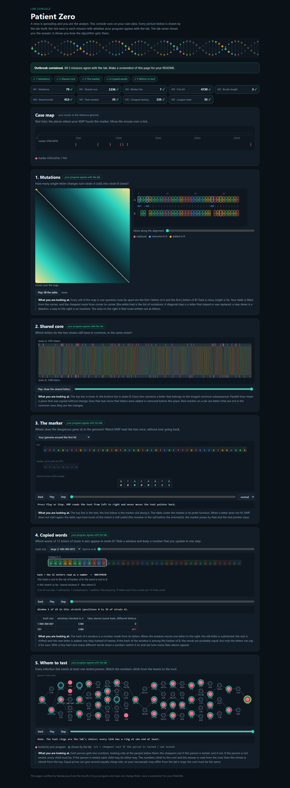

# Assignment 4. Patient Zero

Student ID (barcode): **250671**  
Name: **Amir Kabdilmalik**  
Group: **SE-2532**

## Run

Requires JDK 17 or newer. Run commands from this folder, which contains `src` and `data`.

```text
javac -encoding UTF-8 -d out src/*.java
java -cp out Main
java tools/Check.java
java -cp out Bench
```

In IntelliJ IDEA, open this folder, choose JDK 17+, mark `src` as Sources Root and run `Main` with the project folder as the working directory. The included data were generated by `java tools/MakeVariant.java 250671 data`.

## Program output

```text
Mutations: 79
Shared core: 1236
Marker hits: 7
First hit: 4739
Border length: 3
Shared words: 613
Tests needed: 33
Cheapest testing: 135
Longest chain: 25
```

The minimum number of tests and the cheapest tests are separate optimizations: the cheapest solution is not required to use exactly 33 people. The longest chain is measured in edges; positions in the genome start from zero.

My outbreak report:



Open `output/outbreak.html` in a browser to explore the supplied animations. The console independently confirms all nine values.

## Questions

**Mission 1.** `d[i][j]` is the minimum number of edits needed to turn the first `i` letters of A into the first `j` letters of B. I take the minimum of deleting (`d[i-1][j]+1`), inserting (`d[i][j-1]+1`), or matching/replacing (`d[i-1][j-1]` plus 0/1); the initial row and column are `d[0][j]=j` and `d[i][0]=i`.

**Mission 2.** A subsequence can skip letters while keeping their order; a substring must be consecutive. Insertions and deletions shift positions, so the same letters can still contribute to the shared core even when their indexes differ; here the LCS length is 1236.

**Mission 3.** `pi[i]` gives the longest proper prefix of the marker prefix ending at `i` that is also its suffix. KMP reuses that matched border after a mismatch and changes only the marker pointer, so the text pointer never moves backward; after a full match it also falls back to `pi[m-1]` to keep overlaps. My marker is `GTACAGTA`, its prefix table is `[0,0,0,0,0,1,2,3]`, and its border length is 3 because `GTA` occurs at both ends.

**Mission 4.** Different words can have the same numerical hash, so I compare all `k` letters before counting a position, and count each position in A at most once. Many equal hashes from different words cause many failed candidate comparisons and can make the algorithm quadratic in the numbers of windows, times `k`; equal words are counted correctly and stop the candidate loop on the first exact match.

**Mission 5.** `dp[v][1]` is the cheapest cost in the subtree when v is tested, and `dp[v][0]` is the cheapest when v is not tested: `dp[v][1]=cost[v]+sum(min(dp[c][0],dp[c][1]))`, and `dp[v][0]=sum(dp[c][1])`. I take the cheaper root state and reconstruct the choices; if a parent is not tested its child must be tested, otherwise I choose the child's cheaper state. A greedy maximum-degree choice ignores prices: on a star with three leaves, a centre costing 9 is worse than testing all three leaves costing 1 each.

## AI use

OpenAI Codex (ChatGPT) was used to generate the implementations for Missions 1-5, run checks and benchmarks, prepare the report and screenshot, and explain the algorithms. The local commit history records the actual AI-assisted implementation steps, with the assistant as commit author; it does not represent independent student work. The starter code, lab console, data generator and benchmark were supplied with the assignment; no external solution code was copied.

This is an AI-assisted draft for study and review. Before submitting, I need to understand the implementations, review and adapt the explanations in my own words, and follow the course rules on AI assistance.

## Timing (Mission 7)

Actual output of the unmodified `Bench`, milliseconds, average of 3 runs, Microsoft OpenJDK 21.0.13 on this Windows machine:

| test | size | time (ms) |
|---|---|---|
| naive search | 20 000 / 40 000 / 80 000 | 46.2 / 86.7 / 177.5 |
| KMP | 20 000 / 40 000 / 80 000 | 2.3 / 1.1 / 0.3 |
| edit distance | 500 / 1000 / 2000 / 4000 | 4.8 / 5.2 / 12.8 / 53.3 |

For the fixed 2000-character pattern, doubling the text makes naive search about 1.88x and 2.05x slower; its general worst case is O(nm), while KMP is O(n+m). These very short KMP measurements decrease because early runs include JVM warm-up and compilation, so they do not demonstrate the scaling law reliably. Edit distance computes a quadratic table, so doubling both lengths should approach 4x work; the largest doubling measured 4.16x, while the smaller tests were affected by warm-up and allocation effects.

Raw measurements are preserved in `output/timing.txt`; they were not adjusted to fit a theoretical trend.

## Complexity

Here n and m are the two strain lengths for edit distance/LCS; for KMP they are text and marker lengths. For shared words, n and m are the lengths of A and B, k is the window length (12 in Main), h is the number of hits, and v is the number of people.

| algorithm | time | space | assumptions |
|---|---|---|---|
| Edit distance | O(nm) | O(nm) | Full table, constant work per cell; empty strings use the initial row/column. |
| LCS | O(nm) | O(nm) | Full table of prefix answers. |
| Prefix function | O(m) | O(m) | Fallbacks are amortized linear. |
| KMP including prefix function | O(n+m) | O(m+h) | Includes the returned hits; overlaps count. Empty marker matches all n+1 boundaries. |
| Rabin-Karp (shared words) | Expected O(n+m+qk); worst O(nmk) | O(m) | q is the number of candidate comparisons. Rolling updates are O(1), hash-map operations expected O(1); few false collisions give q=O(n). For fixed k=12 the usual expected bound is O(n+m). All B window positions are stored. |
| Tree DP and reconstruction | O(v) | O(v) | A connected undirected tree; includes DP arrays, answer and recursion stack. Costs are accumulated as long. |
| Tree diameter | O(v) | O(v) | Two longest downward branches per vertex; recursion depth can reach v. |

## Validation and submission status

- The original tiny, small and dense checks pass: all nine lines in each case.
- 500 seeded randomized tests pass against independent naive/exhaustive oracles. Run with: `javac -encoding UTF-8 -d out src/*.java tools/SelfTest.java` then `java -cp out SelfTest`.
- The personal run completed in approximately 0.21 seconds, including startup and HTML generation (under one minute).
- Personal data, actual program output, benchmark output, generated console and full-page screenshot are included.
- Main, Input, Render, Generator, Bench and the lab template remain unchanged from the starter.
- The local main branch contains the starter commit and a separate implementation commit for each of Missions 1-5.
- Public GitHub publication and uploading the repository link to Moodle have not been performed. These are still required for submission.
